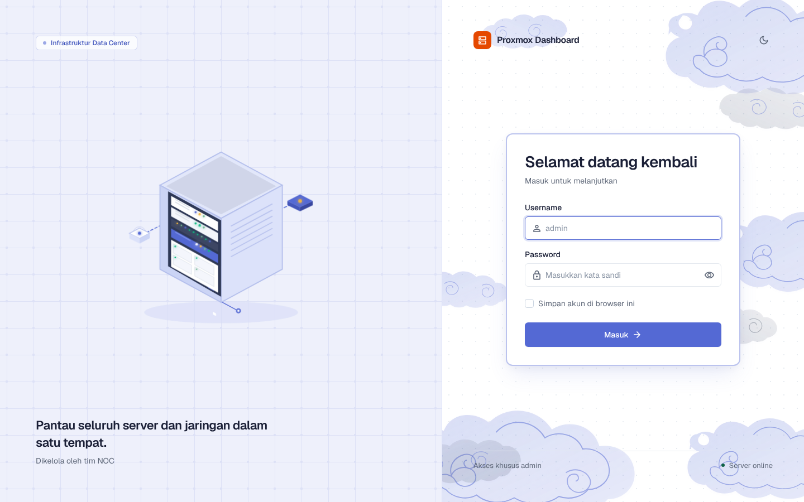
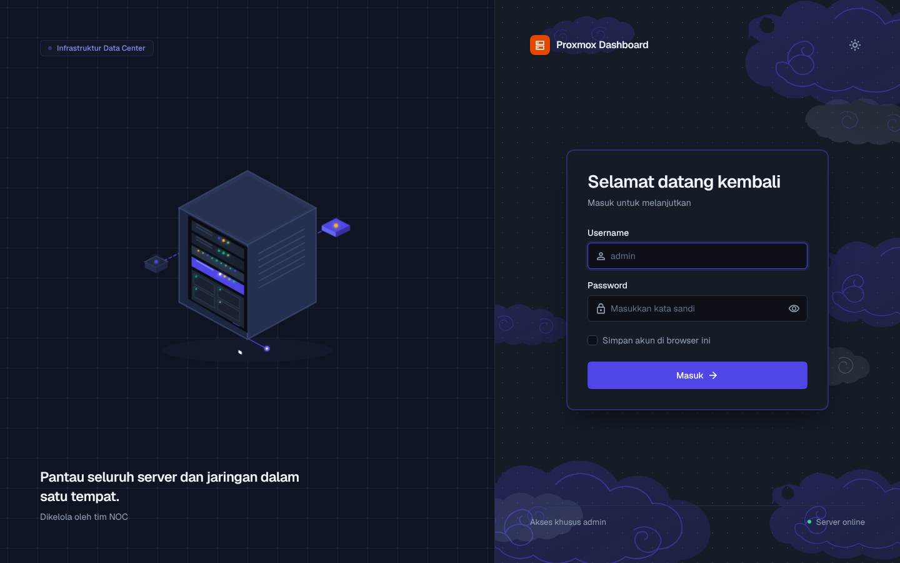
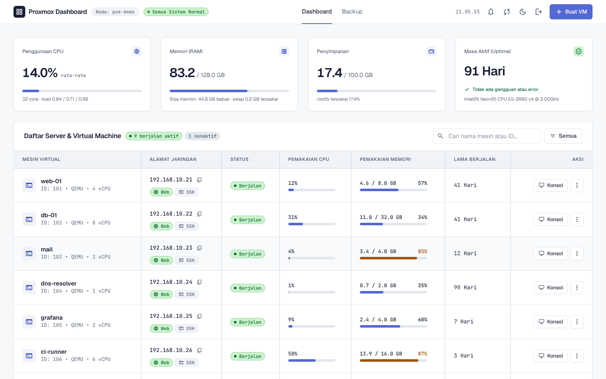
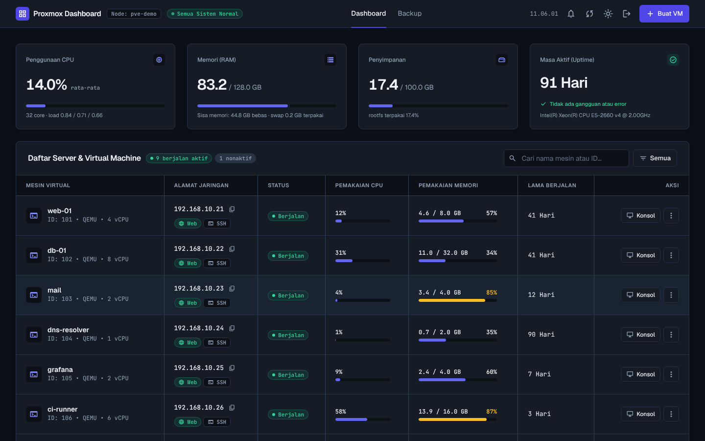
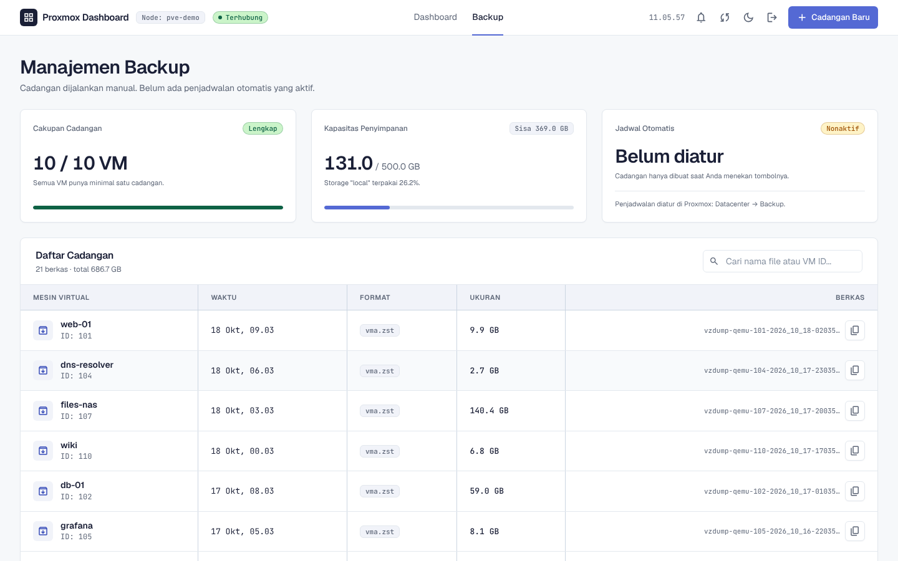
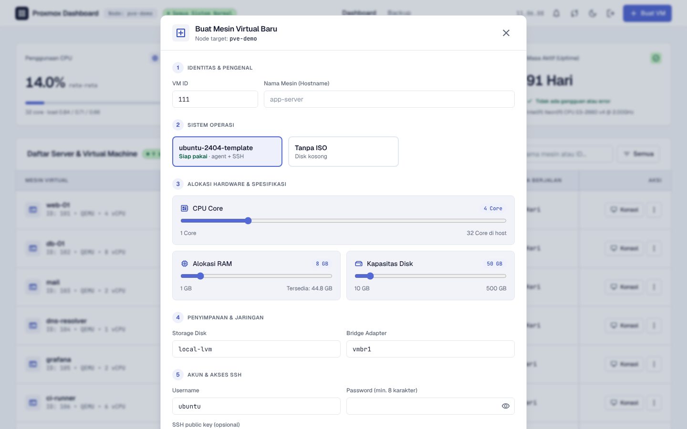

# Proxmox Monitor

Dashboard web untuk memantau node Proxmox VE: CPU, RAM, penyimpanan, daftar VM, backup, konsol VM, dan pembuatan VM dari template. Dibuat sebagai alat internal tim NOC agar angka yang tampil lebih jelas daripada tampilan bawaan Proxmox, terutama pemisahan **RAM asli vs cache**.

> **Repo ini berisi studi kasus, bukan kode sumber.** Proyek ini dipakai di lingkungan kerja dan terhubung ke server produksi, jadi kodenya tidak dipublikasikan. Semua tangkapan layar di bawah diambil dari server Proxmox tiruan dengan data fiktif; tidak ada data server sungguhan.

## Tampilan

| Login terang | Login gelap |
|---|---|
|  |  |

| Dashboard terang | Dashboard gelap |
|---|---|
|  |  |

| Manajemen backup | Buat VM dari template |
|---|---|
|  |  |

Login juga menampilkan pesan bila password salah ([gambar](docs/screenshots/02-login-salah.png)), dan tampilannya menyesuaikan layar HP ([gambar](docs/screenshots/06-mobile.png)).

## Masalah yang dipecahkan

Proxmox menampilkan pemakaian RAM VM dari proses QEMU di host. Angka itu ikut menghitung page cache di dalam guest, sehingga VM dengan aplikasi ringan tetap terlihat terpakai 80-90%. Dashboard ini membaca data balloon dari dalam guest untuk memisahkan RAM yang benar-benar dipakai dari cache. Bila VM belum mengaktifkan Ballooning Device atau QEMU Guest Agent, dashboard menulis "tidak diketahui" dan tidak menampilkan angka tebakan.

## Fitur

- **Ringkasan node**: CPU, RAM, swap, penyimpanan, load, dan uptime, diperbarui otomatis tiap beberapa detik.
- **Daftar VM**: status, alamat IP, pemakaian CPU dan memori, lama berjalan, pencarian, dan filter. VM yang memori-nya di atas 80% atau 90% diberi warna peringatan.
- **Kontrol VM**: start, stop, shutdown, reboot, dan konsol di browser (noVNC). Browser tidak pernah bicara langsung ke Proxmox; server meneruskan koneksi memakai API token.
- **Backup**: daftar file backup per VM, kapasitas penyimpanan, cakupan (VM mana yang belum punya backup), dan tombol cadangan baru.
- **Buat VM**: dari template cloud-init (IP statis, user, SSH key) atau VM kosong dengan ISO. Sebelum membuat, IP diperiksa terhadap VM yang ada dan dengan ping, supaya tidak bentrok.
- **Peta IP**: pemakaian satu rentang jaringan VM, dari data Proxmox ditambah hasil ping.
- **Hapus VM** dengan konfirmasi eksplisit, dan hanya untuk VM yang sudah mati.
- **Tema terang dan gelap**, mengikuti sistem atau pilihan manual.

## Keamanan

- Semua halaman, API, dan konsol butuh login; hanya halaman login yang terbuka. Sesi berlaku 12 jam dengan cookie `HttpOnly` dan `SameSite=Lax`.
- Password dibandingkan dengan `timingSafeEqual`, dan login yang salah diperlambat satu detik.
- Akses ke Proxmox memakai API token, bukan akun penuh. Rahasia hanya ada di `.env` yang tidak masuk repo.
- Input yang dirangkai ke opsi Proxmox (storage, bridge, ISO, IP, gateway) divalidasi, dan tanda koma ditolak untuk mencegah penyisipan opsi.

## Teknologi

Node.js 20+, Express 4, `ws` untuk relay konsol, API REST Proxmox VE 8, HTML dan JavaScript biasa dengan Tailwind CSS, noVNC untuk konsol. Desain dibuat dengan Google Stitch lalu dipindahkan ke komponen dengan token warna terpusat untuk dua tema. Tanpa database: riwayat grafik memakai RRD bawaan Proxmox.

## Pengujian

Ada tes untuk ambang peringatan, peta IP, pemetaan tombol tempel ke konsol, serta validasi cloud-init dan nama VM.

## Belum dibuat (sengaja)

- Riwayat jangka panjang di database; RRD Proxmox sudah cukup untuk kebutuhan sekarang.
- HTTPS; dashboard dipakai di LAN, dan cookie login perlu reverse proxy dengan sertifikat bila dibuka di luar LAN.
- Restore dari backup; lebih aman lewat antarmuka Proxmox.
- Banyak node; semua endpoint terikat ke satu node.

## Kontak

Ardha Febrian Muqorrobin, [asammanis89.github.io](https://asammanis89.github.io)
