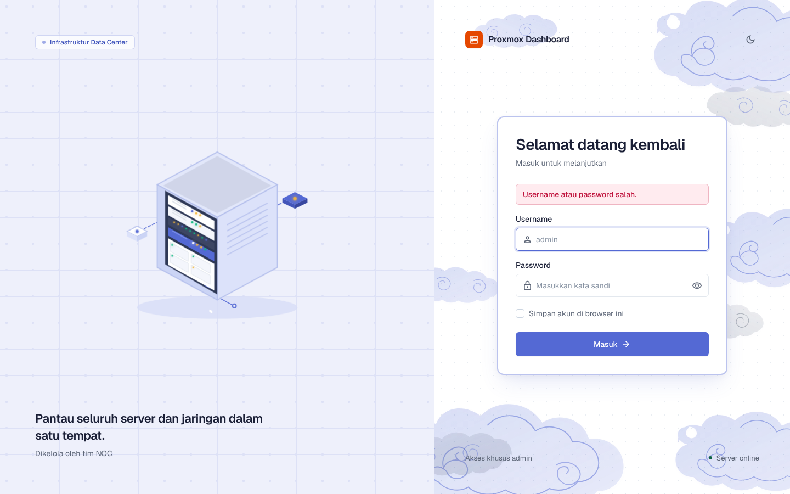
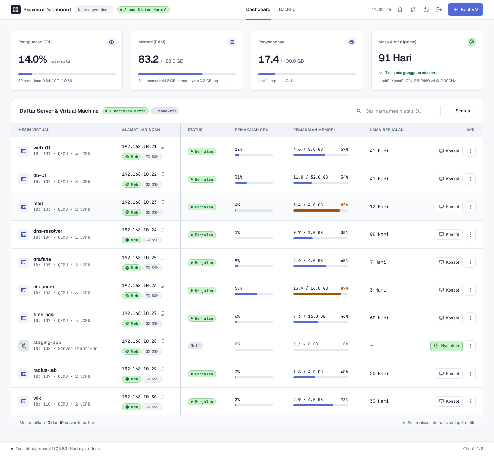
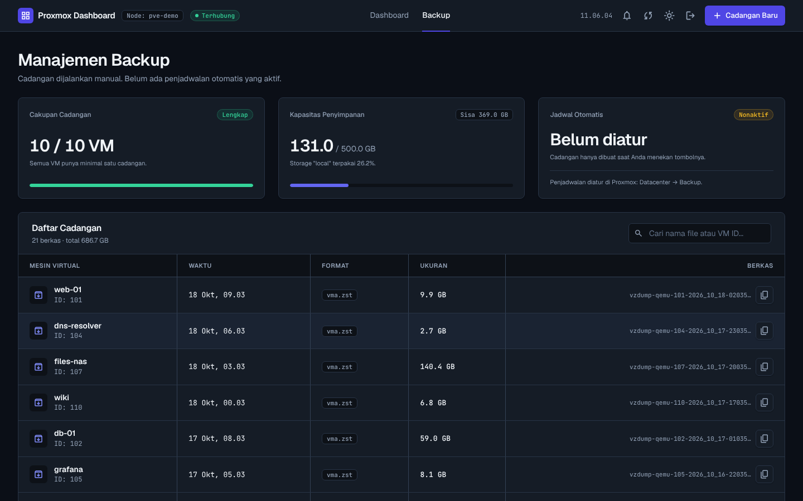
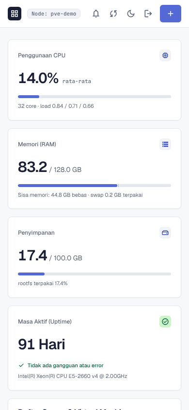
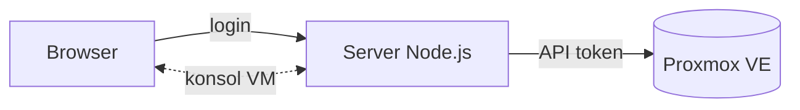

# Proxmox Monitor

Dashboard web untuk memantau server Proxmox: CPU, RAM, penyimpanan, daftar VM, backup, konsol VM, dan pembuatan VM baru dari template. Dibuat untuk tim NOC.

> Repo ini berisi studi kasus, bukan kode sumber. Proyek ini dipakai di lingkungan kerja dan terhubung ke server produksi, jadi kodenya tidak dipublikasikan. Semua gambar diambil dari server Proxmox tiruan dengan data fiktif. Tidak ada data server sungguhan di sini.

## Kenapa dibuat

Di tampilan bawaan Proxmox, VM yang aplikasinya ringan sering terlihat memakai RAM 80 sampai 90 persen. Angka itu ikut menghitung cache di dalam VM, bukan memori yang benar-benar dipakai aplikasi. Hasilnya, orang yang memantau jadi sering mengira server hampir penuh padahal masih longgar.

Dashboard ini saya buat supaya angka yang tampil bisa dipercaya, dan supaya hal yang paling sering dikerjakan tim NOC (cek VM, cek backup, buka konsol, bikin VM baru) ada di satu halaman yang sederhana.

## Apa yang jadi lebih mudah

- **RAM yang jujur.** Memori yang dipakai aplikasi dipisahkan dari cache. Kalau VM belum bisa melaporkannya, tertulis "tidak diketahui", bukan angka tebakan.
- **Semua VM dalam satu tabel**, lengkap dengan IP, pemakaian, dan warna peringatan saat memori hampir penuh.
- **Buat VM tanpa bentrok IP.** Alamat yang diminta diperiksa dulu terhadap VM yang ada dan dengan ping. Kalau sudah dipakai, pembuatan berhenti sebelum ada yang dibuat.
- **Cek backup sekilas.** Kelihatan VM mana yang belum punya cadangan dan sisa kapasitas penyimpanan.
- **Konsol VM langsung di browser**, tanpa membuka antarmuka Proxmox.

## Tampilan

### Masuk, dengan dua tema

| Terang | Gelap |
|---|---|
|  |  |

Halaman login memberi pesan jelas kalau password salah, dan tema mengikuti pengaturan sistem atau pilihan manual.

### Dashboard

| Terang | Gelap |
|---|---|
|  |  |

Bagian atas menampilkan CPU, RAM, swap, penyimpanan, load, dan uptime node, yang diperbarui otomatis. Di bawahnya daftar VM dengan status, IP, pemakaian CPU dan memori, serta lama berjalan. Bisa dicari dan difilter, dan tombol start, stop, reboot, serta konsol ada di tiap baris.

### Backup

| Terang | Gelap |
|---|---|
|  |  |

Daftar file backup per VM, kapasitas penyimpanan, dan tombol cadangan baru. Cadangan dibuat dalam mode snapshot, jadi VM tetap berjalan selama dicadangkan.

### Buat VM dari template

Isi nama, CPU, RAM, disk, dan alamat IP. Sistem memeriksa isian dan IP, lalu menggandakan template, mengatur jaringan dan cloud-init, memperbesar disk, dan menyalakannya.

### Di ponsel

## Cara kerjanya

Browser tidak pernah bicara langsung ke Proxmox. Semua lewat server, yang memeriksa login dulu lalu memanggil Proxmox dengan API token, jadi akun Proxmox sendiri tidak pernah ada di browser.

Untuk RAM, server membaca data memori dari dalam VM. Memori terpakai dihitung dari total dikurangi yang bebas di dalam VM, dan selisihnya dengan angka bawaan Proxmox ditampilkan sebagai cache. Untuk konsol, server menukar tiket Proxmox dengan kode acak yang hanya berlaku satu kali dan satu menit, sehingga tidak bisa dipakai ulang.

## Teknologi

Node.js, Express, API Proxmox VE 8, HTML dan JavaScript biasa dengan Tailwind CSS, noVNC untuk konsol. Desain awal dibuat dengan Google Stitch. Tidak memakai database, karena grafik riwayat diambil dari data bawaan Proxmox.

## Kontak

Ardha Febrian Muqorrobin, [asammanis89.github.io](https://asammanis89.github.io)
